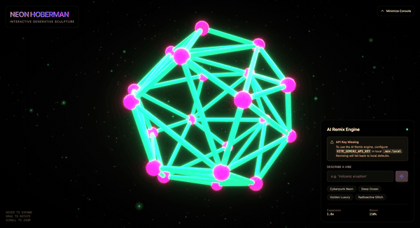
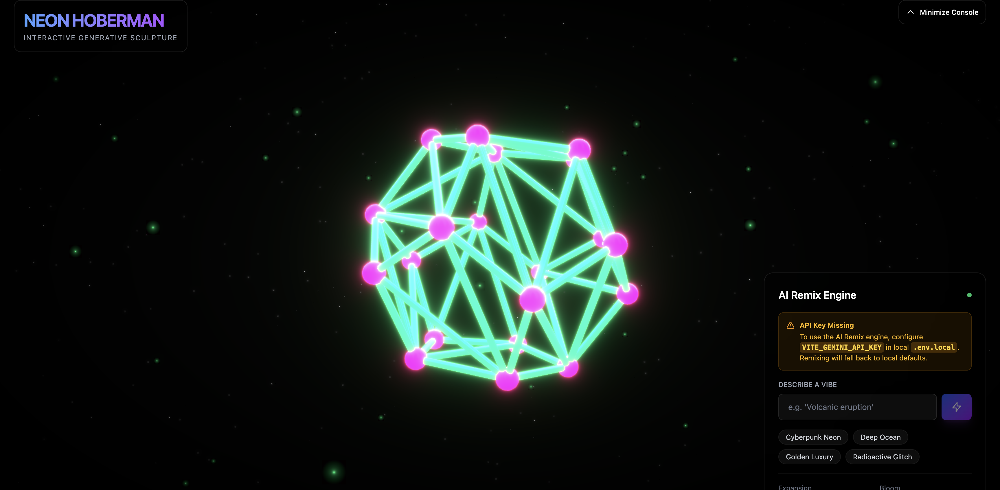
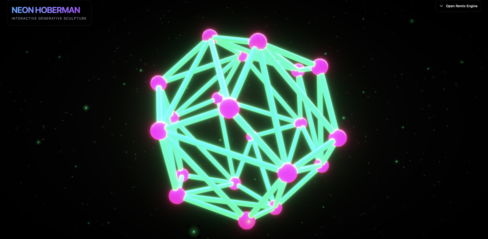

# Neon Hoberman



A generative, interactive 3D Hoberman sphere visualizer featuring responsive hover expansions, click-triggered atom explosions, and an AI remix engine.

## Quick Start

```bash
git clone https://github.com/andrewvoirol/ais-neon-hoberman.git
cd ais-neon-hoberman
npm install
npm run dev
```
*Node.js 18+ required.*

## How It Works

1. **Hover to Breathe:** Move your cursor near the structure to trigger smooth expansion physics.
2. **Orbit & Zoom:** Click and drag the canvas to rotate the sculpture in 3D, and scroll to zoom.
3. **Trigger Explosions:** Left-click on any pink joint (atom) to blow it apart, then watch the spring-physics animation pull the structure back together.
4. **Vibe Remixing:** Type a vibe (e.g., "Cyberpunk Neon" or "Volcanic eruption") and hit the lightning bolt. The app sends the request to the Gemini API, which generates a brand-new color configuration, bloom intensity, and expansion speed.

### Tech Stack

| Component | Technology |
| :--- | :--- |
| **Framework** | React 19 + Vite |
| **Styling** | Tailwind CSS v4 |
| **Language** | TypeScript |
| **3D Rendering** | Three.js |
| **React 3D Suite** | `@react-three/fiber`, `@react-three/drei`, `@react-three/postprocessing` |
| **Generative AI** | `@google/genai` (Gemini 2.5 Flash) |

---

## Interactive Layouts

| Main Remix Controls | Minimized Fullscreen View |
| :---: | :---: |
|  |  |

---

## AI Setup (Optional)

To enable the generative AI styling, copy the template `.env.local` and add your Gemini API key:

```env
VITE_GEMINI_API_KEY=AIzaSy...
```
